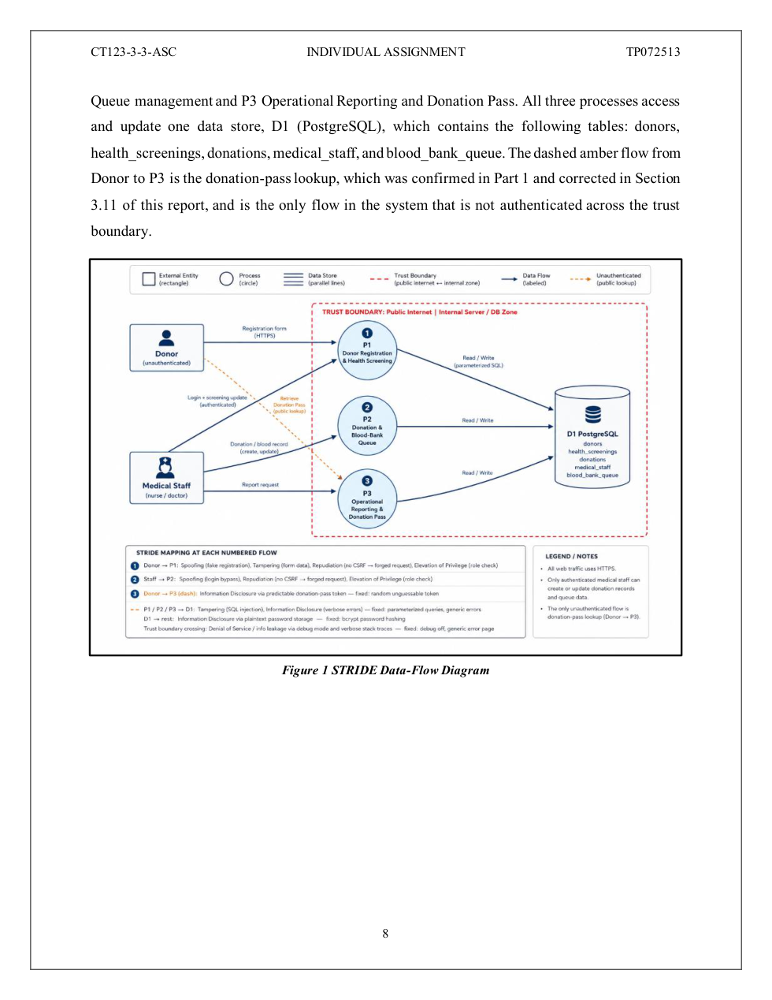
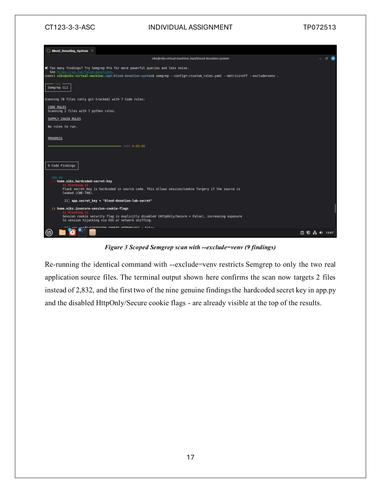
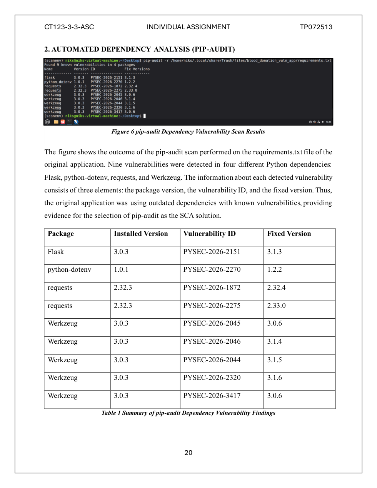
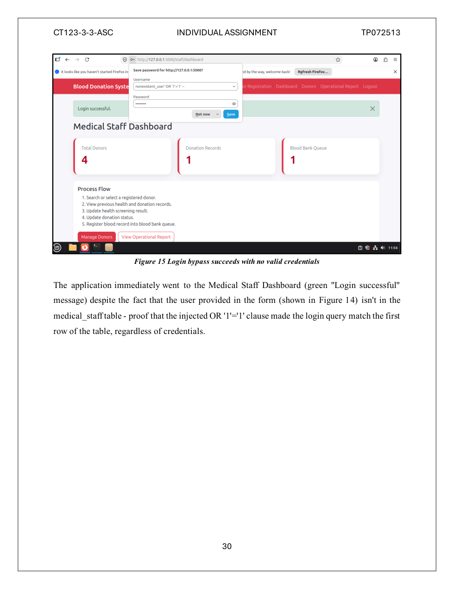
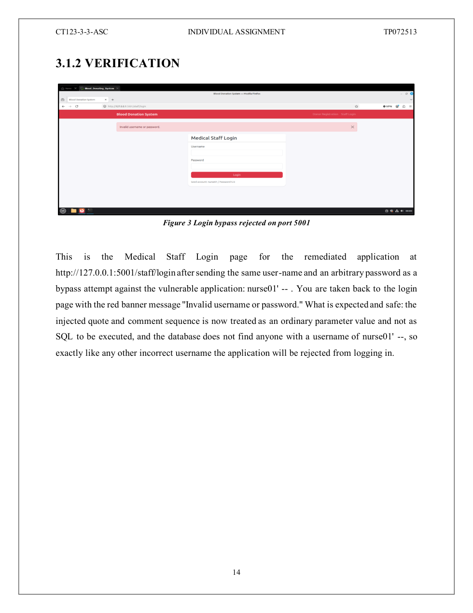
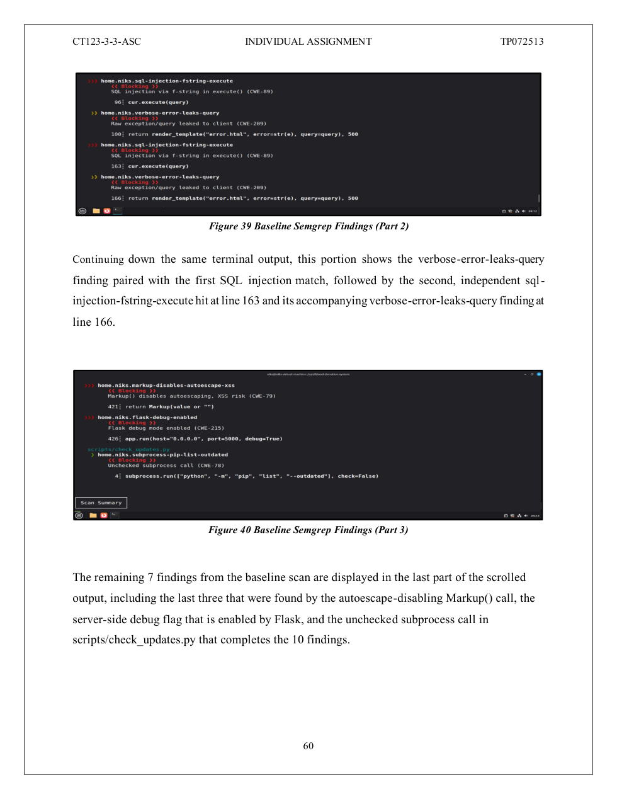
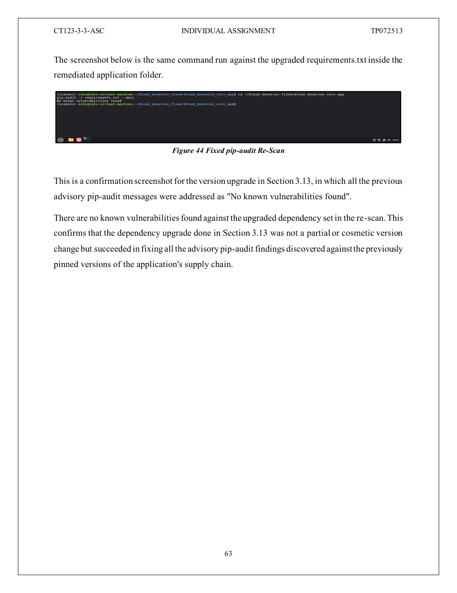
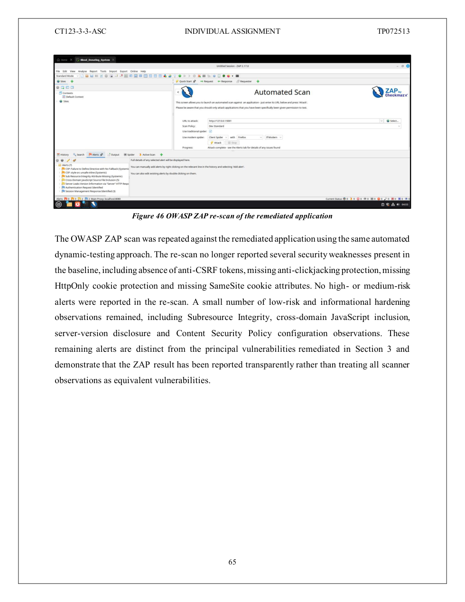
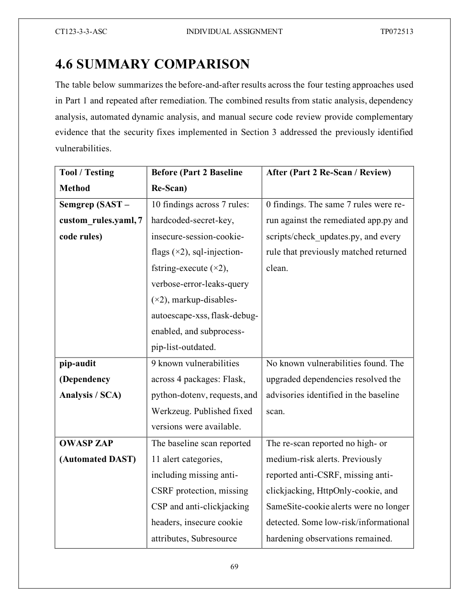

# Blood Donation System — Secure Software Engineering & Vulnerability Remediation

**Individual cybersecurity project | Advanced Software Security | Asia Pacific University | 2026**

An end-to-end application security assessment and remediation case study for a **Flask/PostgreSQL blood donation management system**. The work covers secure design, source-code and dependency analysis, dynamic application testing, threat modelling, remediation, and repeatable before-and-after verification.

> **Scope:** This repository documents an academic security assessment and controlled remediation of an existing application. It is a security engineering case study, not a claim that I originally developed the blood donation application. The full assessment and implementation reports are included; application source code is not included in this repository.

## Project at a glance

| Area | Work completed |
| --- | --- |
| Application | Flask, PostgreSQL, Jinja2; donor registration, health screening, donation queue, operational reporting and donation passes |
| Initial assessment | **12 confirmed vulnerabilities** plus **1 potential security-hardening finding** |
| Threat modelling | STRIDE-based data-flow diagram and mapping of threats to security fixes |
| Static analysis | Semgrep with custom rules and manual secure code review |
| Dependency security | pip-audit |
| Dynamic analysis | OWASP ZAP and manual runtime validation |
| Remediation | Individual fixes, followed by repeat testing against the corrected application |
| Verification environment | Original application on **port 5000**, remediated application on **port 5001** |

## Security engineering workflow

```text
Application & code review
         |
         v
Threat identification (STRIDE + DFD)
         |
         v
SAST (Semgrep) + SCA (pip-audit)
         |
         v
DAST (OWASP ZAP) + manual validation
         |
         v
Risk-based remediation of confirmed findings
         |
         v
Before/after regression testing and evidence
```

## 1. Threat modelling and architecture

The model distinguishes public donors from authenticated medical staff and maps the application's three processes—registration/health screening, donation and blood-bank queue management, and operational reporting/donation passes—to a PostgreSQL data store. Trust boundaries and all six **STRIDE** categories were assessed.



*Source: Part 2, page 8. Full-size diagram is available in the accompanying report.*

## 2. Vulnerabilities assessed and remediated

The reports document the following **12 confirmed findings**, plus one separate potential hardening issue:

| # | Finding | Remediation approach |
| --- | --- | --- |
| 1 | SQL injection — staff login bypass | Parameterized SQL queries |
| 2 | SQL injection — donor search | Parameterized SQL queries |
| 3 | Plaintext password storage | Password hashing and verification |
| 4 | Broken access control / operational report exposure | Role-based authorization and data minimization |
| 5 | Stored cross-site scripting (XSS) | Safe template output and escaping |
| 6 | Missing CSRF protection | CSRF tokens and request validation |
| 7 | Insecure session cookie configuration | Hardened cookie settings |
| 8 | Hardcoded application secret | Environment-managed secrets |
| 9 | Debug mode enabled | Disable debug in production configuration |
| 10 | Verbose errors / SQL information leakage | Generic client-facing errors and controlled logging |
| 11 | Predictable donation-pass reference (IDOR) | Signed tokens and server-side verification |
| 12 | Outdated or vulnerable third-party dependencies | Dependency upgrades and re-audit |
| — | Security-sensitive subprocess invocation | Preventive hardening; **potential/not confirmed** |

**Important distinction:** The subprocess finding was treated as a potential hardening concern, not as a confirmed exploited vulnerability.

## 3. Vulnerability discovery and validation

The initial assessment combined Semgrep custom-rule scanning, pip-audit, OWASP ZAP, manual code review, and controlled runtime tests. An early unscoped Semgrep scan included virtual-environment files, so the scan scope was corrected to focus on application code and reduce third-party noise.







## 4. Secure coding and remediation

For each finding, Part 2 documents the vulnerable behavior, corresponding code-level change, and verification evidence. The original and remediated applications were operated side by side, allowing the same tests to be compared under controlled conditions.

**Example — staff-login SQL injection:** User-supplied usernames were changed from string-interpolated SQL to parameterized database queries. The original bypass attempt was then rejected by the corrected login flow.



## 5. Before-and-after security verification

The corrected application was re-evaluated using the same complementary testing methods. The reports provide the detailed results, findings, caveats, and evidence for each stage.









A successful rescan is evidence of improvement against the tested cases; it is not a guarantee that every possible vulnerability has been eliminated.

## 6. Tools and technologies

`Python` · `Flask` · `PostgreSQL` · `Jinja2` · `Semgrep` · `pip-audit` · `OWASP ZAP` · `OWASP Threat Dragon` · `STRIDE` · `CWE` · `SAST` · `DAST` · `Manual Security Testing`

SonarQube was evaluated as part of the proposed secure-coding approach; the hands-on assessment and re-verification evidence primarily uses Semgrep, pip-audit, OWASP ZAP, and manual methods.

## 7. Full technical documentation

- **[Part 1 — Security Assessment and Proposed Remediation](Security-Assessment-Part-1.pdf)** (69 pages): design/coding/testing analysis, tool comparison, source-code and runtime assessment, findings, and remediation methodology.
- **[Part 2 — Threat Modelling, Fix Implementation and Verification](Security-Remediation-Part-2.pdf)** (78 pages): STRIDE mapping, individual remediation steps, code and runtime evidence, and before-and-after security testing.

The screenshots above are taken from these reports. For complete code excerpts, test evidence, and context, consult the linked PDFs.

## 8. Skills demonstrated

- Vulnerability assessment and technical evidence collection
- Secure code review and risk-driven remediation
- STRIDE threat modelling and trust-boundary analysis
- SAST, DAST, and software composition analysis
- Authentication, authorization, session and input-handling security
- Security regression testing and before/after validation
- Professional security documentation and reporting

## Academic attribution

**Individual assignment:** Advanced Software Security (CT123-3-3-ASC), Asia Pacific University, 2026. Prepared by **Fairouz Abdulrahman Hamed Mousa**.

**Responsible-use note:** All security testing described in the reports was performed in the project assessment environment. Do not run these tests against systems without explicit authorization.
